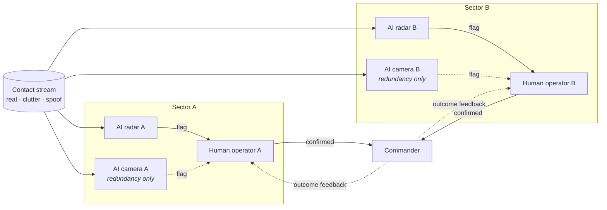
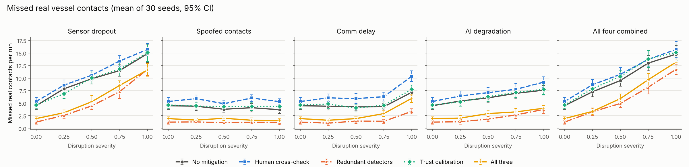
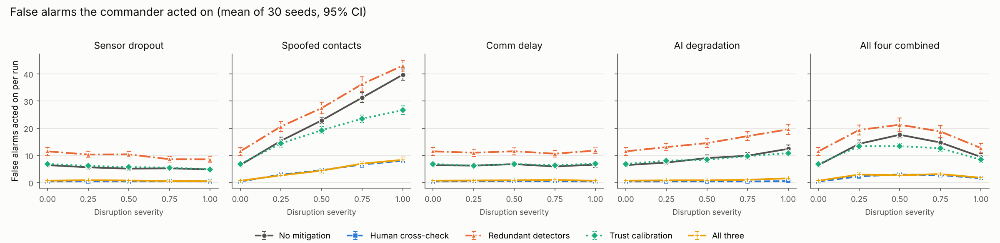
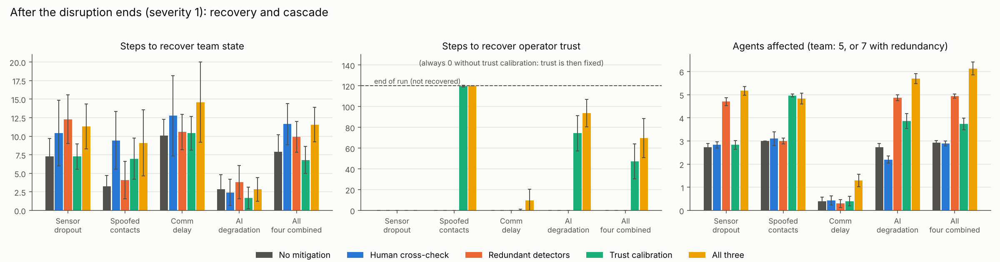

# Resilience of human-AI teams under disruption: an agent-based simulation

> **Read this first.** This is a deliberately simplified model with **assumed parameters**.
> It has **not** been calibrated or validated against real maritime operations, sensor data or
> operator studies. The results show what *follows from these assumptions*. They are not
> predictions about any real watch team. Treat it as a reasoning tool and a portfolio piece.

## The question

When an AI-assisted watch team is hit by technical or cyber disruption, **how does the damage
spread from machines to people to decisions, and which mitigations actually help?**

The scenario is a maritime watch team. AI detectors (radar and, optionally, camera) flag vessel
contacts. Human operators verify or accept those flags. A commander acts on what reaches them.

## Quick start

```bash
python3.11 -m venv .venv && source .venv/bin/activate   # Windows: .venv\Scripts\activate
pip install -r requirements.txt
pytest                                # 39 tests, ~2 s
python scripts/run_experiments.py     # 3,750 runs, ~20 s on 4 cores; writes results/ and figures/
```

All randomness is seeded. Running `run_experiments.py` twice gives byte-identical `results/runs.csv`.

## Model design



The team structure is a `networkx.DiGraph`. Every message (flag, confirmation, feedback) travels
along a graph edge through a message bus, so communication delay applies to every hop.
Built on **Mesa 3.3.1**: `mesa.Model(rng=seed)`, `mesa.Agent(model)`, `model.agents_by_type[...].do(...)`.
One step represents about one minute. Each run lasts 300 steps, and disruptions are active
from step 100 to 180.

| Agent | Rules |
|---|---|
| **Contact stream** | Each step: Poisson(0.15) real vessels, Poisson(0.5) clutter, and during spoofing Poisson(0.5 × severity) spoofed tracks. Each contact is in one of two sectors. A real contact must reach the commander within **20 steps** or it counts as missed. |
| **AIDetector** | Looks once at each new contact in its sector. Radar: P(flag \| real) = 0.90, P(flag \| clutter) = 0.05, P(flag \| spoof) = 0.95, latency 1. Camera: 0.80 / 0.05 / **0** (an RF spoof is invisible to an optical sensor), latency 2. Online/offline Markov chain with rare random faults. |
| **HumanOperator** | FIFO queue of flags. Duplicate flags of one contact merge into one item; flags from 2 detectors make it "corroborated". For each item: **verify** with probability 1 − trust (halved when overloaded, a simple automation-bias rule), otherwise **accept**. Verifying costs 2.5 work units, accepting 0.5, and capacity is 1 unit per step. Verification is right 97% of the time for real contacts, 95% for clutter and 80% for spoofs. Overloaded = more than 5 items waiting. Fatigue builds while overloaded and cuts capacity by up to 30%. Stale items (past the deadline) are dropped. |
| **Commander** | Acts on every confirmed contact once. Five steps later, sends the forwarding operator feedback on whether the contact was real. |

### Disruptions (each switchable, severity 0–1)

| Disruption | Mechanism at severity *s* |
|---|---|
| Sensor dropout | Detector failure probability per step rises by 0.2·*s* and repair slows, so each detector is offline about *s* of the time during the window |
| Spoofed contacts | Poisson(0.5·*s*) fake tracks per step that radar flags 95% of the time and humans reject only 80% of the time |
| Communication delay | Every message sent during the window gets an extra Poisson(8·*s*) steps of delay |
| AI model degradation | Over the window, recall falls linearly to (1 − 0.6·*s*) of normal and the false-positive rate rises by 0.3·*s*. This hits **all** AI detectors (a common-mode fault, e.g. a shared bad model update). The model is rolled back when the window ends. |

### Mitigations (each switchable)

| Mitigation | Mechanism |
|---|---|
| Human cross-checking | Procedure: operators verify **every** flag unless two detectors agree on it |
| Redundant detectors | Adds a camera per sector, with different modality and independent errors |
| Trust calibration | Trust tracks observed AI precision: `trust += 0.1 × (outcome − trust)`. The outcome is 0 when the operator catches an AI error or the commander reports a false alarm, and 1 when a forwarded contact is confirmed real. Without this mitigation, trust stays fixed at 0.8. |

### Metrics (per run)

- **Missed real contacts:** real contacts not acted on within the deadline. Only contacts whose deadline falls inside the run are counted, about 41 per run.
- **False alarms acted on:** commander actions on clutter or spoofs.
- **Operator overload time:** operator-steps spent overloaded.
- **Recovery time:** steps after the disruption ends until the team's *operating state* is normal for 10 consecutive steps. Normal means all detectors online, no operator overloaded, queue and in-flight message counts at or below their pre-disruption 95th percentile, and fatigue near its pre-disruption level. If the team never gets there, the value is censored at 120 (end of run).
- **Trust recovery time:** same idea, for mean operator trust returning to within 0.1 of its pre-disruption mean.
- **Cascade size:** the number of agents whose rate of abnormal states during the disruption (plus 20 steps) is more than 5 percentage points above their own pre-disruption rate. Abnormal states are: detector offline, degraded or relaying a spoof; operator overloaded or with trust more than 0.15 below base; commander acting on a false alarm or missing a deadline.

### Experiment

5 disruption settings (each alone, plus all four combined) × 5 severities (0, 0.25, 0.5, 0.75, 1)
× 5 mitigation settings (none, each alone, all three) × **30 seeds** = **3,750 runs**.
The same 30 seeds are used in every setting, and the contact stream has its own RNG, so every
setting faces identical real and clutter traffic (common random numbers).
Outputs: `results/runs.csv` (one row per run), `results/summary.csv` (means and 95% CIs),
and `results/results_table.md`.

## Results

### Table: all four disruptions combined (mean ± 95% CI over 30 seeds)

| Severity | Mitigation | Missed real | False alarms acted | Overload (op-steps) | Recovery (steps) | Trust recovery (steps) | Cascade (agents) |
|---|---|---|---|---|---|---|---|
| 0 | No mitigation | 4.5 ± 0.7 | 6.4 ± 0.8 | 0.0 ± 0.0 | 1.8 ± 1.8 | 0.0 ± 0.0 | 0.0 ± 0.1 |
| 0 | Human cross-check | 5.3 ± 0.8 | 0.4 ± 0.2 | 0.0 ± 0.0 | 2.4 ± 2.6 | 0.0 ± 0.0 | 0.0 ± 0.1 |
| 0 | Redundant detectors | 1.2 ± 0.4 | 11.5 ± 1.4 | 0.0 ± 0.0 | 2.6 ± 2.7 | 0.0 ± 0.0 | 0.2 ± 0.1 |
| 0 | Trust calibration | 4.6 ± 0.7 | 6.8 ± 0.7 | 0.0 ± 0.0 | 1.1 ± 1.1 | 2.0 ± 3.9 | 0.3 ± 0.2 |
| 0 | All three | 1.9 ± 0.5 | 0.7 ± 0.3 | 0.0 ± 0.0 | 3.5 ± 2.7 | 8.0 ± 8.6 | 0.7 ± 0.3 |
| 0.5 | No mitigation | 9.5 ± 1.1 | 17.6 ± 1.1 | 0.0 ± 0.0 | 8.0 ± 2.2 | 0.0 ± 0.0 | 3.0 ± 0.0 |
| 0.5 | Human cross-check | 10.7 ± 1.3 | 3.0 ± 0.5 | 0.1 ± 0.1 | 9.2 ± 3.7 | 0.0 ± 0.0 | 2.8 ± 0.2 |
| 0.5 | Redundant detectors | 4.9 ± 0.8 | 21.3 ± 2.5 | 0.0 ± 0.0 | 9.1 ± 3.1 | 0.0 ± 0.0 | 4.9 ± 0.1 |
| 0.5 | Trust calibration | 10.3 ± 1.1 | 13.4 ± 0.8 | 0.0 ± 0.0 | 7.0 ± 1.5 | 103.5 ± 9.5 | 4.8 ± 0.2 |
| 0.5 | All three | 5.9 ± 0.9 | 2.7 ± 0.6 | 0.0 ± 0.0 | 8.0 ± 2.0 | 107.1 ± 8.7 | 6.6 ± 0.2 |
| 1 | No mitigation | 14.8 ± 1.7 | 9.4 ± 1.3 | 0.0 ± 0.0 | 7.9 ± 2.3 | 0.0 ± 0.0 | 2.9 ± 0.1 |
| 1 | Human cross-check | 15.7 ± 1.6 | 1.5 ± 0.4 | 0.1 ± 0.1 | 11.6 ± 2.8 | 0.0 ± 0.0 | 2.9 ± 0.1 |
| 1 | Redundant detectors | 11.7 ± 1.0 | 12.7 ± 1.8 | 0.0 ± 0.0 | 9.9 ± 2.1 | 0.0 ± 0.0 | 4.9 ± 0.1 |
| 1 | Trust calibration | 15.1 ± 1.7 | 8.4 ± 0.9 | 0.0 ± 0.0 | 6.8 ± 1.8 | 47.2 ± 16.8 | 3.7 ± 0.2 |
| 1 | All three | 13.2 ± 1.5 | 1.8 ± 0.5 | 0.0 ± 0.0 | 11.6 ± 2.3 | 69.6 ± 18.9 | 6.1 ± 0.3 |

About 41 real contacts are judged per run. The team has 5 agents, or 7 with redundant detectors.
Per-disruption numbers for every severity are in `results/summary.csv`.

### Figures







## Findings (in plain English, within this model)

1. **Each mitigation fixes one failure mode and makes another worse.** Redundant detectors cut
   missed contacts sharply (undisrupted: 4.5 → 1.2 per run) but almost double false alarms
   (6.4 → 11.5), because either sensor can raise a flag. Human cross-checking does the reverse.
   It nearly eliminates false alarms (6.4 → 0.4) but misses slightly more real contacts, because
   verification takes time. Combining both gets most of each benefit (1.9 missed, 0.7 false alarms).

2. **Cross-checking turns a cyber attack into a workload problem.** Under full spoofing,
   cross-checking cuts false alarms from 39.7 to 8.0 per run. But operators are now verifying
   every fake track: overload rises from about 0 to 7.8 operator-steps, and missed real contacts
   rise from 3.7 to 5.3. Under heavy communication delay, cross-checking adds verification time
   on top of a slow network, and misses rise from 7.2 to 10.4. Procedures that take time are
   most costly exactly when time is short.

3. **Redundancy only helps against independent failures.** Adding a camera roughly halves misses
   under communication delay (7.2 → 3.4) and AI degradation (7.6 → 3.8). It does not stop
   spoofing: the spoof still arrives through the radar, so false alarms stay high (39.7 → 43.0). Against full sensor dropout it
   only reduces misses from 14.9 to 11.7, because both sensors are likely to be down at once.
   Redundancy is no substitute for fixing a common-mode fault.

4. **Trust is quick to lose and slow to rebuild.** With trust calibration, operators learn to
   distrust a spoofed or degraded AI. Under full spoofing, false alarms fall from 39.7 to 26.6.
   But once the disruption ends, trust is rebuilt only from slow outcome feedback. After full
   spoofing it had not recovered by the end of the run in 29 of 30 runs. For the rest of the
   watch, operators verify far more than they need to. The team's *operating state* recovers in
   about 2–15 steps in every scenario. The *human* state lags far behind.

5. **Disruption spreads beyond the component that was hit.** Under the combined disruption,
   about 3 of 5 agents are affected even with no mitigation: detectors, then the commander's
   decisions. Mitigations that add agents or links (cameras, feedback) also add more places for
   a disruption to show up: with all three mitigations, about 6 of 7 agents are affected. A
   bigger cascade here is not necessarily worse. A distrustful operator counts as "affected"
   while also being part of the defence. One non-obvious interaction: at the highest combined
   severity there are *fewer* false alarms than at medium severity (9.4 vs 17.6), because
   detectors that have dropped out cannot pass spoofs on either.

## Assumptions and their limits

- **Every parameter is assumed.** Rates, accuracies, costs, the deadline and the trust learning
  rate are all chosen to give plausible behaviour, not measured. The **direction** of the
  trade-offs is more robust than the **magnitudes**, but even that has not been tested with a
  formal sensitivity analysis.
- **Human behaviour is a few probabilistic rules.** There is no real model of attention,
  communication between operators, expertise, or the commander's judgement. The commander
  acts on everything confirmed and never questions it.
- **Detectors look once.** A real contact missed on arrival is never seen again. Real systems
  track over time, so this overstates the cost of dropout.
- **Disruptions are a single 80-step window** with a clean start and end. Degradation is
  rolled back instantly at the end. Real incidents are messier and may be adaptive: an
  adversary would respond to mitigations.
- **The recovery and cascade definitions are choices.** Their thresholds (95th percentile,
  10-step hold, 5-point margin) change the absolute numbers. At severity 0, recovery is about
  2 steps and cascade about 0.0–0.7 agents, which shows the noise floor. Team-state recovery
  differences between mitigations mostly overlap within their 95% CIs.
- **Small team, short run.** Two sectors and about 41 real contacts per run mean individual
  counts are noisy. That is why 30 seeds are used and CIs are reported.
- **Not validated.** No comparison against operational data, exercises or human-in-the-loop studies.

## Repository layout

```
src/hai_abm/
  config.py       all parameters (one frozen dataclass)
  agents.py       AIDetector, HumanOperator, Commander, Contact
  model.py        WatchTeamModel: team graph, message bus, contact stream, recording
  metrics.py      per-run metrics (recovery and cascade logic as pure functions)
  experiments.py  Monte Carlo sweep and summary statistics
  plotting.py     figures
scripts/run_experiments.py   runs everything, writes results/ and figures/
tests/                       pytest: agent rules, metric calculations, reproducibility
```
